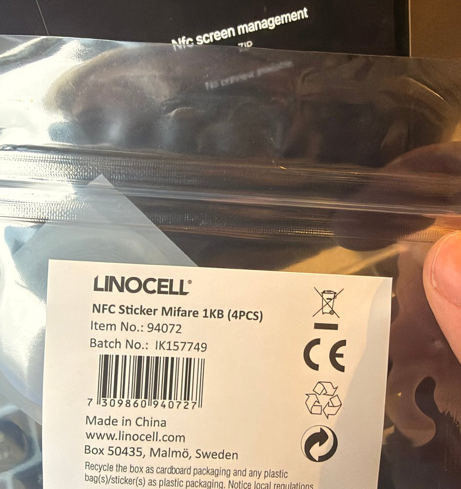
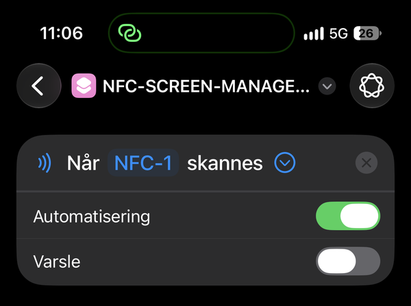
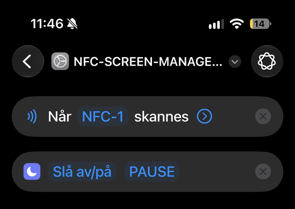
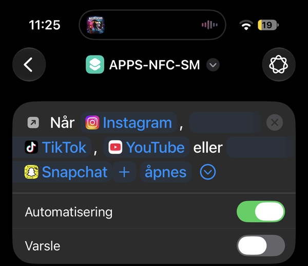
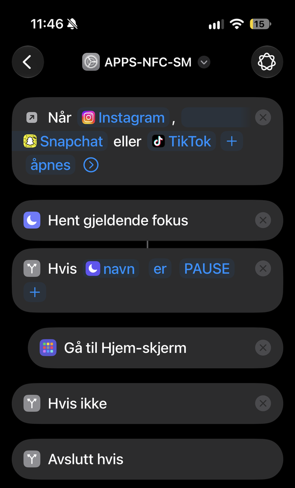
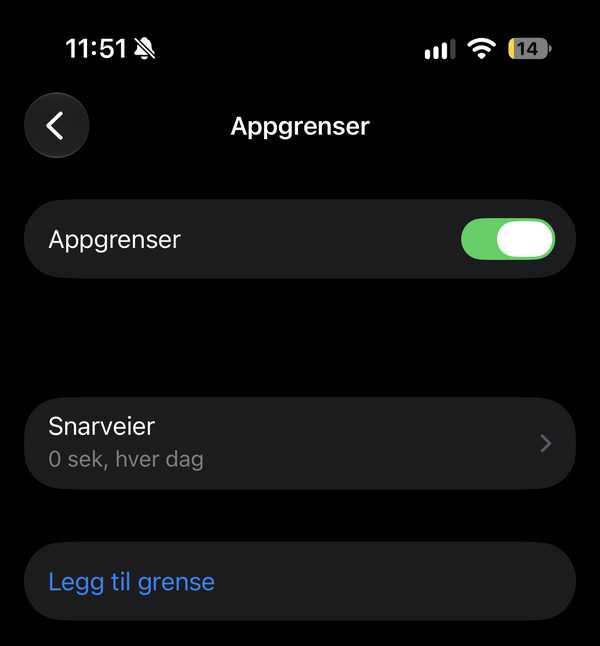

# NFC Screen Management

Tap an NFC tag to lock distracting apps on your iPhone. Tap it again to unlock them.

No app to install, no subscription, no code. Just a cheap NFC tag and the built-in **Shortcuts** app.

  

## The problem it solves

I'm a student, and during exam periods I need to stay focused for many hours at a time. The biggest threat to that isn't a lack of motivation. It's autopilot. I pick up my phone without thinking, open an app out of pure habit, and twenty minutes of scrolling later I've lost my flow.

Software-only solutions didn't work for me. Screen Time limits have an "Ignore Limit" button, and Focus modes are one swipe away from being switched off. When the barrier is a single tap, my thumb gets past it before my brain even notices.

What I needed was a **physical** barrier:

- **It breaks the habit loop.** Opening a blocked app sends me straight back to the Home Screen, which interrupts the automatic reach-for-the-phone reflex.
- **It makes unlocking a conscious choice.** The only way to unlock is to get up and fetch the tag from another room. If I still want to scroll after that walk, at least it's a decision and not a reflex.
- **It makes starting a session a ritual.** Tapping the tag at my desk is a clear "now I'm working" signal, and the lock stays on for as long as the study session lasts, whether that's one hour or six.
- **It's cheap and private.** No subscription, no third-party app, no data leaving the phone. Just an NFC sticker and features already built into iOS.

> Inspired by commercial NFC "pause" tokens. This is an independent, do-it-yourself take on the concept and is not affiliated with any product.

---

## How it works

1. A custom **Focus mode** called `Pause` acts as the on/off switch.
2. An **NFC automation** toggles that Focus mode whenever you tap the tag.
3. An **App automation** runs whenever you open one of your chosen apps. If `Pause` is on, it immediately sends you back to the Home Screen.

## Requirements

- iPhone XS / XR or newer (background NFC tag reading)
- A recent version of iOS with the Shortcuts app
- One or more NFC tags. **NTAG213/215/216** and **MIFARE Classic 1K** stickers both work (I use a 4-pack of MIFARE Classic 1K stickers).

The tag doesn't need to be programmed. Shortcuts recognises it by its unique ID.

> **Note on MIFARE Classic:** iPhone can't read or write the *contents* of MIFARE Classic tags, so apps like NFC Tools won't detect them. Shortcuts automations still work because they only use the tag's ID. Test directly in Shortcuts.

## Setup (about 10–15 minutes)

Menu names may differ slightly between iOS versions. The screenshots are from an iPhone set to Norwegian, so the English names are given in the text.

> **Tip:** iOS 26 lets one automation have several triggers (shown as "or"). Keep the NFC trigger and the App trigger in **two separate automations**, otherwise opening a blocked app will toggle the Focus mode.

### 1. Create the "Pause" Focus mode

1. Open **Settings → Focus → +** and choose **Custom**.
2. Name it **`Pause`** and pick an icon (⏸️ works nicely).
3. *(Optional)* Under **Notifications**, only allow the people you want to hear from.
4. *(Optional)* Under **Customize Screens**, choose a Home Screen page that only has useful apps.

### 2. Make the NFC tag toggle the Focus mode

1. Open **Shortcuts**, go to the **Automation** tab, then tap **+**.
2. Choose **NFC**, tap **Scan** and hold the tag near the top of your iPhone. Name it e.g. `Pause tag`.
3. Select **Run Immediately** and turn off **Notify When Run**.
4. Tap **Next → New Blank Automation → Add Action**.
5. Add **Set Focus** (the one with the Settings ⚙️ / moon icon, *not* "Set Focus Filter"). Tap the word "Turn" and change it to **Toggle**, then choose the **`Pause`** Focus.
6. Tap **Done**.

  
  &nbsp;&nbsp;
  

✅ **Test:** Unlock your phone and tap the tag. The Pause icon should appear in the status bar. Tap again and it should disappear.

### 3. Block apps while "Pause" is on

1. In **Automation**, tap **+** and choose **App**.
2. Tap **Choose** and select the apps you want to block (Instagram, TikTok, Snapchat, YouTube…).
3. Select **Is Opened** and **Run Immediately**, and turn off **Notify When Run**.
4. Tap **Next → New Blank Automation** and add these actions in order:

| # | Action | Configuration |
|---|--------|---------------|
| 1 | **Get Current Focus** | – |
| 2 | **If** | Tap the variable → choose **Name**, condition **is**, value `Pause` (must match your Focus name exactly) |
| 3 | **Go to Home Screen** | Drag it *inside* the *If* block (it should be indented, above *Otherwise*) |
| 4 | **Show Notification** | e.g. `⏸️ Pause is on – go get the tag` |

*End If* is added automatically.

  
  &nbsp;&nbsp;
  

✅ **Test:** Turn Pause on with the tag and open one of the blocked apps. You should be sent back to the Home Screen and see the notification.

## Make it harder to cheat

With the basic setup you can still open Shortcuts and switch the automation off. These steps close the easy loopholes:

1. **Block the Shortcuts app with Screen Time.** Settings → Screen Time → App Limits → Add Limit → choose **Shortcuts**, set the limit to **0–1 minute** and turn on **Block at End of Limit**. The automations keep running in the background, but you can no longer edit or disable them on a whim.
2. **Let someone else set the Screen Time passcode.** Settings → Screen Time → Use Screen Time Passcode. Without a passcode, the limit only shows an "Ignore Limit" button. When you need to change the setup, tap *Ask For More Time* and have them enter it.
3. **Remove Focus from Control Center**, so the Focus mode can't be switched off with one swipe.

  

> iOS doesn't let you pick Shortcuts or Settings as an App trigger, so they can't be "bounced" the same way as other apps. Turning the Focus off manually in Settings → Focus is still possible, but it takes several deliberate steps. That's the point: it's no longer something you do on autopilot.

## Tips

- **Hide the tag.** The whole point is the walk to get it.
- **Multiple tags:** Create one NFC automation per tag, all with the same *Toggle Focus* action. For example, one at your desk and one by the door.
- **Different modes:** Create more Focus modes (e.g. `Study`, `Evening`) with their own tags and app lists.

## Limitations

This is a lightweight, honest-friction tool, not a hard lock.

- You can still turn off the Focus mode manually in Settings → Focus, or ask Siri to turn it off.
- The blocked app may flash on screen for a split second before you're sent back.
- A true lock needs Apple's Screen Time API (Family Controls), which requires a native app and a paid Apple Developer account.

## Troubleshooting

| Problem | Fix |
|---------|-----|
| Tapping the tag does nothing | Make sure the phone is **unlocked** and that the tag is an NTAG or MIFARE Classic type. Hold it against the very top edge of the phone. |
| Blocked apps still open | In the *If* action, change the condition from **is** to **contains**, and check that the Focus mode is named exactly `Pause`. |
| A confirmation pops up every time | Edit the automation and make sure **Run Immediately** is selected. |

## Screenshots

All screenshots live in [`screenshots/`](screenshots/).

## License

[MIT](LICENSE)
